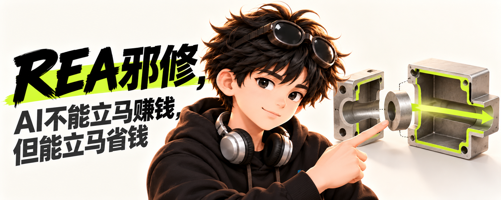

# Lany Cover Skill

为「Lany 小生」制作 X 长文、帖子和公众号的个人 IP 封面。调用时按**头像参考 → 人物风格 → 标题或文章 → 封面语言**四项说明；平台/比例和视觉重点可补充。同一个小生可以是手绘、丝印或潮玩，封面又可以独立选深夜简报、奶白折页等语言。

新封面默认使用自然手绘小生、`night-brief` 深夜简报和一处 `#D8FF00` 强调色。用户已明确反馈这批像素封面表现不佳，因此像素媒介只在明确点名时使用，不进入默认推荐；这不修改账号当前头像。候选风格和测试图不会自动替换长期品牌方向。X 主页 Banner 是另一种画幅与遮挡任务，不在本技能范围内。

## 安装与调用

仓库根目录就是 Codex Skill：[`SKILL.md`](SKILL.md)、`references/`、`assets/` 和 `scripts/` 放在一起，无需安装旁边的 `lany-avatar` 仓库。首次安装到 Windows 的 Codex 技能目录：

```powershell
git clone https://github.com/LanyXiaosheng/lany-cover-skill.git "$env:USERPROFILE\.codex\skills\lany-cover"
py -m pip install -r "$env:USERPROFILE\.codex\skills\lany-cover\requirements.txt"
```

若 `lany-cover` 目录已存在，先检查并保留现有文件，再更新；不要直接在已有目录上运行 `git clone`。如果 `$lany-cover` 未立即出现在可调用列表，重启 Codex 后再试。Python 辅助脚本依赖 [Pillow](https://pillow.readthedocs.io/)；生图本身还需要当前运行环境提供图像生成工具。

```text
使用 $lany-cover 做 X 长文封面。
头像：assets/lany-avatar-handdrawn-reference.png
人物风格：soft-handdrawn
标题：REA邪修，AI不能立马赚钱，但能立马省钱
封面语言：paper-portal
比例：5:2；视觉重点：“省钱”，不编造金额
```

```text
使用 $lany-cover，固定同一标题，分别测试：soft-handdrawn×paper-portal、designer-vinyl×analog-counter、storybook-3d×copper-lines。每组单独出图和验收，不修改我的默认头像。
```

只要提示词时明确说“仅提示词”；未提出多版时默认做一张。尚未选封面语言但想先看选项，可说“推荐三种适合这篇内容的封面语言”；明确说“自动决定”时才替你选。用户本轮指定的头像是身份真源，内置样例只用于媒介与品牌延续。

## 选择风格，不混淆身份

| 变量 | 回答的问题 | 可选例子 |
| --- | --- | --- |
| 人物媒介 | 小生怎么画？ | 自然手绘、丝印、赛璐璐、立体潮玩、毛绒；像素仅明确选中时使用 |
| 封面语言 | 页面怎么组织？ | 深色报告、浅色编辑、撕纸拼贴、高对比印刷、极简画册 |
| 视觉重点 | 读者先看到什么？ | 标题、人物、过程、结果、真实产品 |

十种内置人物媒介及参考图见 [头像媒介目录](references/avatar-styles.md)；独立编写的 33 种封面语言及选择规则见 [封面语言目录](references/cover-languages.md)。封面语言可以与人物媒介交叉搭配；除明确的分镜叙事外，同一张封面只使用同一位小生的一种人物媒介。默认不使用金额、百分比或拟真截图来冒充结果，实际文章与发布平台确定后再设计封面，而不是复用测试图的构图。

## 本轮：33 种原创语言的非像素人物实测

同一 REA 标题下，[完整对照索引](examples/rea-nonpixel-33/index.md)把每张图片、人物媒介、判断和提示词排在一起，不把所有图片堆到文章末尾。02–06 沿用此前的非像素样张；01 与 07–33 为本轮新生成的非像素组合。你对非像素方向整体认可；33 个语言都已实际尝试，其中 07 字流边距、26 图标化、29 俯视构图等仍标为技术上的“待修”，不能仅凭尺寸通过就当成正式成品。

这套语言和图像为小生独立编写与生成。交互上参考了 [Punk-Skill](https://github.com/adrianpunk/Punk-Skill) 的显式选择思路，但不包含其风格规格、提示词或样图；当前批次也没有把像素人物用作新封面参考。

| 08 手绘纸门：隐喻直接 | 10 潮玩模拟工作台：动作具体 |
| --- | --- |
| [](examples/rea-nonpixel-33/08-paper-portal-soft-handdrawn.png) | [](examples/rea-nonpixel-33/10-analog-counter-designer-vinyl.png) |
| 14 温暖三维铜线：张力强 | 20 3D 表情模块板：少一步直观 |
| [](examples/rea-nonpixel-33/14-copper-lines-storybook-3d.png) | [](examples/rea-nonpixel-33/20-modular-board-emoji-3d.png) |
| 24 温暖三维结构剖面：技术感 | 33 丝印轨道：科技感 |
| [](examples/rea-nonpixel-33/24-technical-cutaway-storybook-3d.png) | [](examples/rea-nonpixel-33/33-orbital-shortcut-screenprint.png) |

## 此前六组混搭基线：同一标题，不同表达

测试标题固定为「**REA邪修，AI不能立马赚钱，但能立马省钱**」。每组有独立 [提示词](examples/rea-savings/prompts/) 与最终图；以下是上一轮风格探索。01 像素图因视觉效果未达你的预期，仅保留历史链接，不再作为推荐或默认示例。测试不是对 AI 节省金额的实证，也没有将候选头像升级成账号默认头像。版式拆分思路参考了 [xialingguo-ip](https://github.com/peggykangkang02/xialingguo-ip)，没有复用其人物或图片素材。

| 编号 | 人物 × 封面 | 本轮观察 |
| --- | --- | --- |
| 01 | 像素 × 浅色编辑杂志 | 用户反馈视觉效果未达预期；仅留档，不推荐 |
| 02 | 自然手绘 × 深色报告 | 稳重、适合长文，可继续精修 |
| 03 | 赛璐璐 × 撕纸拼贴 | 抓眼，但元素较多，长期使用可能冲淡识别 |
| 04 | 丝印 × 高对比实测 | “邪修”冲击力强；发布前可收敛颗粒与黄绿面积 |
| 05 | 立体潮玩 × 极简画册 | 干净，适合作为专题实验 |
| 06 | 毛绒 × 手写结果 | 有亲和力，更适合轻松主题 |

| 02 手绘 × 深色报告 | 03 赛璐璐 × 撕纸拼贴 |
| --- | --- |
| [](examples/rea-savings/02-handdrawn-dark.png) · [提示词](examples/rea-savings/prompts/02-handdrawn-dark.md) | [](examples/rea-savings/03-cel-anime-collage.png) · [提示词](examples/rea-savings/prompts/03-cel-anime-collage.md) |
| 04 丝印 × 高对比实测 | 05 立体潮玩 × 极简画册 |
| [](examples/rea-savings/04-screenprint-proof.png) · [提示词](examples/rea-savings/prompts/04-screenprint-proof.md) | [](examples/rea-savings/05-vinyl-result.png) · [提示词](examples/rea-savings/prompts/05-vinyl-result.md) |
| 06 毛绒 × 手写结果 | |
| [](examples/rea-savings/06-plush-handwritten.png) · [提示词](examples/rea-savings/prompts/06-plush-handwritten.md) | |

当前优先精修 **04 丝印版**和 **02 手绘深色版**；[01 像素历史图](examples/rea-savings/01-pixel-editorial.png)及其[提示词](examples/rea-savings/prompts/01-pixel-editorial.md)仅供复盘，不再推荐。六张最终 PNG 均为 `1500×600`，已按选定背景模式做脚本检查，并目视核对标题与人物。脚本只能验证尺寸与简单背景特征，正式发布前仍需对照文章复核标题、视觉隐喻和结果表述。更早的「赛博小晚」[像素](examples/cyber-xiaowan/cover-pixel.png)与[手绘](examples/cyber-xiaowan/cover-soft-handdrawn.png)测试也保留在 `examples/`。

## 文件与验收约定

- X 长文默认 `5:2`、正式尺寸 `1500×600`；公众号默认 `2.35:1`，正文头图默认 `16:9`。用户指定比例或尺寸时以本次要求为准，不裁一张图兼容多个平台。
- 提示词、生成源图和最终图分开保存到 `<项目根>/lany-assets/lany-cover/<主题>/`。同名文件加 `-v2`、`-v3`，不覆盖已有结果。本仓库 `examples/` 只收录最终测试图与提示词，原始源图仍保留在本地创作目录。
- `scripts/prepare_reference.py` 生成轻量人物参考；`scripts/finalize_ratio.py` 仅在标题、脸和主体均落在目标安全区时裁切；`scripts/validate_output.py` 验证尺寸及深/浅背景启发式。`mixed` 模式只验证尺寸，不能替代目视检查。
- 辅助脚本不会替你判断错字、陌生脸、伪造数据或裁切后的视觉质量。任何一个不通过就继续修正，不把失败图作为正式封面交付。

```powershell
py scripts/validate_output.py examples/rea-nonpixel-33/08-paper-portal-soft-handdrawn.png --size 1500x600 --background light
```

修改辅助脚本后运行 `py -m unittest discover -s tests -v`；Codex 的展示名称与默认调用语位于 `agents/openai.yaml`。
