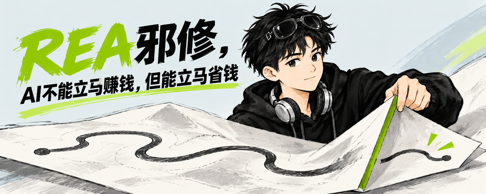
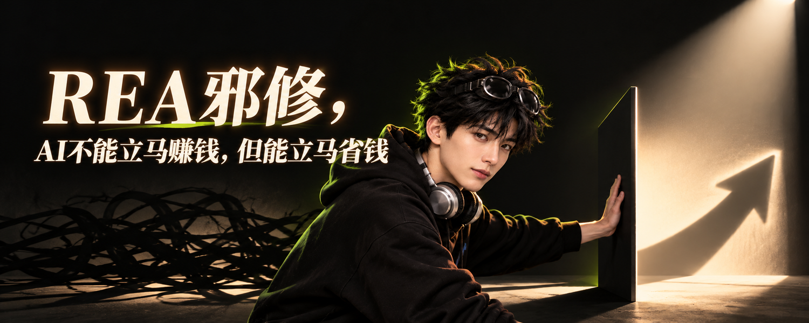
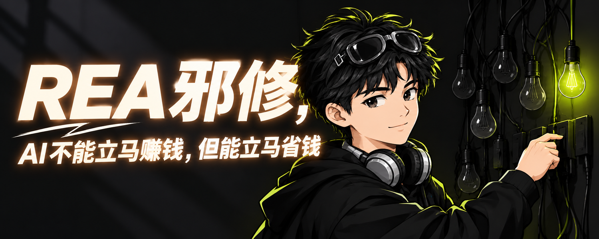
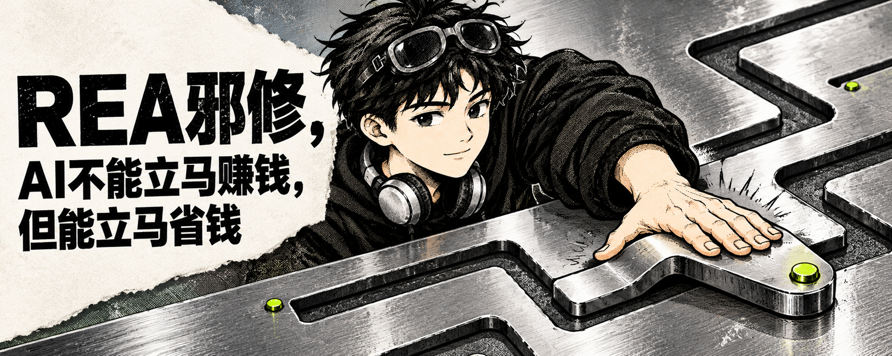
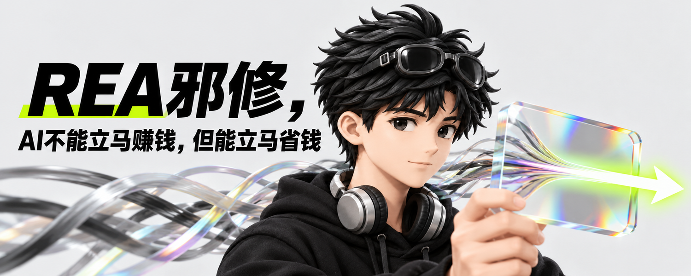
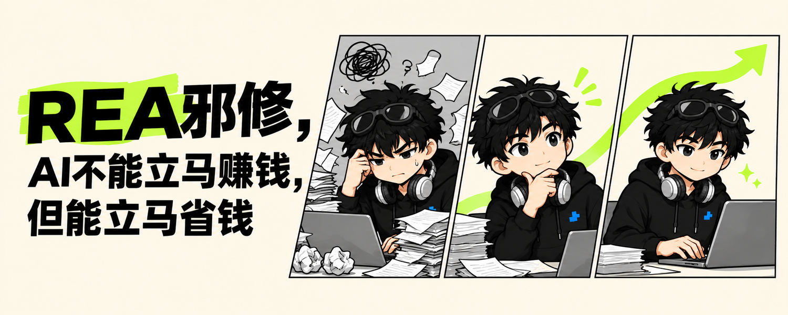
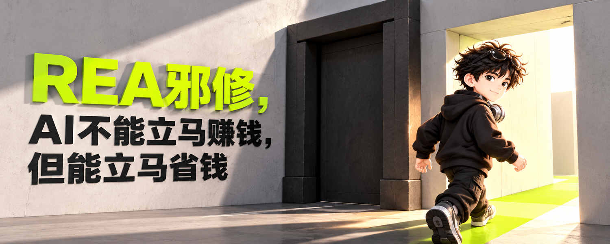

# REA 封面：33 种原创语言 × 非像素小生

> 测试标题固定为“REA邪修，AI不能立马赚钱，但能立马省钱”。这是一组视觉探索，不是 AI 节省金额的实证。各语言是独立编写的 Lany 封面规则，未复制 Punk-Skill 的风格规格、提示词或样图。

02–06 为此前已生成的非像素样张；01 与 07–33 为本轮新增。每种语言至少实际生成一张非像素人物图。头像媒介在各行标出，因此这是组合探索，不是只改变封面语言的严格 A/B 测试。失败首稿留在本地创作目录，没有收进本页；此处图片均为 1500×600。

自动脚本只检查尺寸及深/浅背景启发式；混合背景只查尺寸。发布前仍需逐字复核标题、人物身份、裁切安全区与视觉隐喻。标为“待修/待核”的图只是试验记录，不是可直接发布的成品。生成样张不会改变默认头像。

| 语言与人物 | 本轮判断 | 对应图片与提示词 |
| --- | --- | --- |
| 01 奶白折页 · soft-handdrawn | 候选：右侧纸张有微小伪字，发布前须重做细节 |  · [提示词](prompts/01-cream-fold-soft-handdrawn.md) |
| 02 深夜简报 · soft-handdrawn | 优先：深色长文气质稳重，既有测试样张 |  · [提示词](../rea-savings/prompts/02-handdrawn-dark.md) |
| 03 批注拼版 · cel-anime | 探索：纸片较多，视觉噪声偏高 |  · [提示词](../rea-savings/prompts/03-cel-anime-collage.md) |
| 04 粗墨冲击 · screenprint | 优先精修：冲击力强，需再收印刷颗粒 |  · [提示词](../rea-savings/prompts/04-screenprint-proof.md) |
| 05 单物画册 · designer-vinyl | 专题候选：人物偏潮玩，不宜直接替换日常默认 |  · [提示词](../rea-savings/prompts/05-vinyl-result.md) |
| 06 手记结果 · plush | 轻松内容候选：亲和力强，技术感偏弱 |  · [提示词](../rea-savings/prompts/06-plush-handwritten.md) |
| 07 字流穿行 · cel-anime | 待修：第三稿无存钱罐，但标题左边距仍偏紧 |  · [提示词](prompts/07-letter-stream-cel-anime-v3.md) |
| 08 纸门捷径 · soft-handdrawn | 优先：手绘人物与纸门捷径关系清楚 |  · [提示词](prompts/08-paper-portal-soft-handdrawn.md) |
| 09 炭笔擦亮 · screenprint | 可选：黑白对比强，适合方法长文 |  · [提示词](prompts/09-charcoal-clear-screenprint.md) |
| 10 模拟工作台 · designer-vinyl | 优先：机械少走一步的隐喻直观 |  · [提示词](prompts/10-analog-counter-designer-vinyl.md) |
| 11 透光层叠 · emoji-3d | 可选：透明层清楚，视觉略常规 |  · [提示词](prompts/11-glass-layers-emoji-3d.md) |
| 12 档案袋 · flat-comic | 可选：档案桌清楚，右侧动作偏重 |  · [提示词](prompts/12-archive-sleeves-flat-comic.md) |
| 13 信号缎带 · plush | 轻松内容候选：毛绒材质很有记忆点 |  · [提示词](prompts/13-signal-ribbon-plush.md) |
| 14 铜线通路 · storybook-3d | 优先：铜线拆环的动作与主题贴合 |  · [提示词](prompts/14-copper-lines-storybook-3d.md) |
| 15 粉笔推演 · photo-style | 探索：粉笔箭头可能被读成增长结果 |  · [提示词](prompts/15-chalk-sequence-photo-style.md) |
| 16 陶土薄片 · designer-vinyl | 待核：标题标点需放大复核 |  · [提示词](prompts/16-clay-panels-designer-vinyl.md) |
| 17 负片显影 · cel-anime | 可选：负片显影有知识感 |  · [提示词](prompts/17-negative-film-cel-anime.md) |
| 18 编织路径 · plush | 轻松内容候选：线头隐喻直观但可爱 |  · [提示词](prompts/18-woven-paths-plush.md) |
| 19 折叠路线 · soft-handdrawn | 可选：折叠路线清楚，略有地图感 |  · [提示词](prompts/19-folded-route-soft-handdrawn.md) |
| 20 可拆模块 · emoji-3d | 优先：取掉冗余模块的动作直接 |  · [提示词](prompts/20-modular-board-emoji-3d.md) |
| 21 影子剧场 · photo-style | 探索：影子箭头有增长联想 |  · [提示词](prompts/21-shadow-stage-photo-style.md) |
| 22 墨迹留白 · soft-handdrawn | 可选：很克制，但省钱关系不够具体 |  · [提示词](prompts/22-ink-breath-soft-handdrawn.md) |
| 23 电光字牌 · cel-anime | 高冲击候选：适合社媒，灯管细节略多 |  · [提示词](prompts/23-electric-sign-cel-anime.md) |
| 24 结构剖面 · storybook-3d | 优先：虚构剖面准确表达去掉夹层 |  · [提示词](prompts/24-technical-cutaway-storybook-3d.md) |
| 25 晨光渐层 · photo-style | 探索：情绪好，信息密度偏低 |  · [提示词](prompts/25-sunrise-gradient-photo-style.md) |
| 26 贴纸工作板 · flat-comic | 待修：图标串联跑成流程图 |  · [提示词](prompts/26-sticker-board-flat-comic.md) |
| 27 金属压印 · screenprint | 可选：金属材料感强，人物动作可再收 |  · [提示词](prompts/27-metal-press-screenprint.md) |
| 28 棱镜卡片 · designer-vinyl | 可选：棱镜卡片有新鲜感，标题清楚 |  · [提示词](prompts/28-prismatic-card-designer-vinyl.md) |
| 29 俯视小房间 · emoji-3d | 待修：没有形成预期俯视构图 |  · [提示词](prompts/29-isometric-room-emoji-3d.md) |
| 30 三格转折 · flat-comic | 探索：三格叙事完整，但阅读量偏大 |  · [提示词](prompts/30-comic-triptych-flat-comic.md) |
| 31 修枝生长 · plush | 可选：修枝隐喻直观，偏生活化 |  · [提示词](prompts/31-branch-pruning-plush.md) |
| 32 空间门廊 · storybook-3d | 可选：明暗门廊过渡明确 |  · [提示词](prompts/32-architectural-threshold-storybook-3d.md) |
| 33 轨道捷径 · screenprint | 优先：科技感和短路径关系清楚 |  · [提示词](prompts/33-orbital-shortcut-screenprint.md) |

本轮值得先精修的方向：08 纸门捷径（解释清晰）、10 模拟工作台（机制具象）、14 铜线通路（主题张力）、20 可拆模块（少一步直观）、24 结构剖面（技术感）、33 轨道捷径（科技识别）。具体发布选哪张，还需对照正式文章内容和账号近期视觉。
